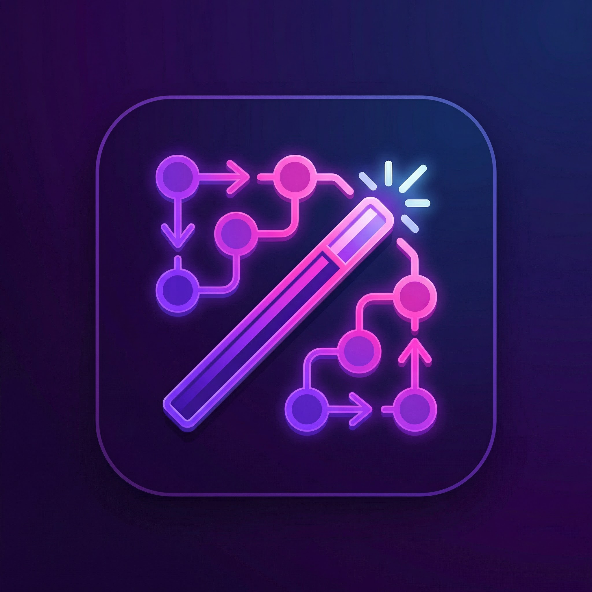
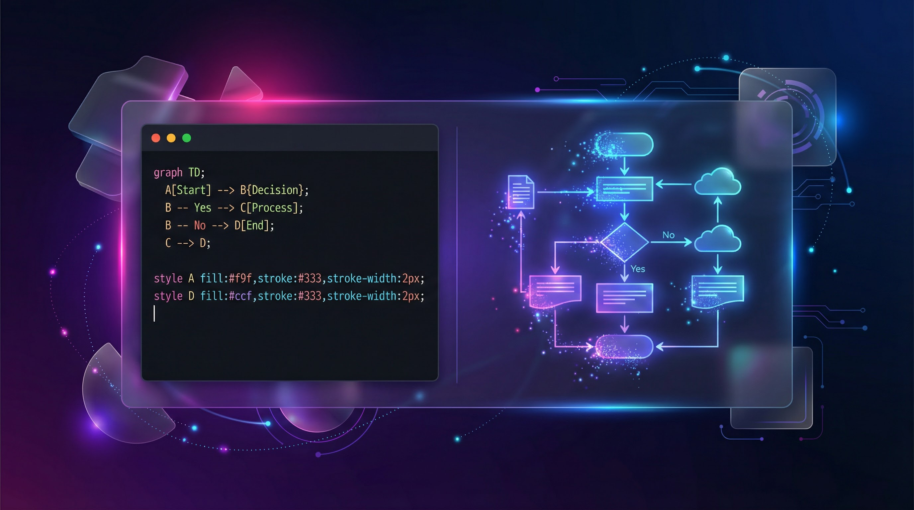

<div align="center">



# DiagramMagic

### Describe It. Diagram It. Done.

**AI-powered diagram generation: type what you want in plain English, get Mermaid diagrams you can edit, preview, and export.**

[](https://diagrammagic.lovable.app)
[](https://www.typescriptlang.org/)
[](https://react.dev)
[](https://tailwindcss.com)
[](https://supabase.com)

[Try It Live](#try-it-live) · [Features](#features) · [Diagram Types](#supported-diagram-types) · [Quick Start](#quick-start) · [Templates](#templates)

---



</div>

## Why this exists

**What it does.** DiagramMagic is a React and Vite editor that turns a plain-English prompt into Mermaid code through a Supabase Edge Function (`supabase/functions/generate-diagram`) that calls the OpenAI API, renders the result live with Mermaid.js, and exports SVG. Nine Mermaid diagram types are supported (flowchart, sequence, class, ER, Gantt, pie, state, user journey, git graph), 12 templates ship in `src/data/templates.ts`, and signed-in users can save diagrams to a Supabase-backed library.

**Who it serves.** Developers, product managers, and instructors who need a flowchart or sequence diagram for a document, pull request, or lesson in minutes and would rather edit generated Mermaid text than drag boxes around a canvas.

**Why Alex built it.** The problem statement added in the branding pass (commit `95855de`, 2026-02-18, "feat: state-of-the-art README, cover art, icon, and branding") records the motivation: drag-and-drop tools are slow, learning Mermaid syntax takes time, and a five-minute flowchart for a meeting should not mean fighting a diagramming tool. The project began as a Lovable remix on 2025-10-11 (first commit `a3fb33b`, "Initial commit from remix"), gained its template library and AI prompt dataset the same week (`7eaf21e`, `b718704`), moved AI calls behind a Supabase Edge Function proxy with restricted CORS on 2026-02-02 (`275858d`, `88260b0`), and had unsupported marketing claims replaced with observable editor features on 2026-10-18 (`8cfb6de`) ahead of the October 2026 dependency and license-status PRs (#1 to #4).

**Real-world use case (2025-2026 evidence).** **Proposed use case.** An engineer documenting a service types "sequence diagram: client, API gateway, auth service, token refresh", edits the generated Mermaid in the live editor, and pastes it into a GitHub README or pull request where it renders natively. Text-based diagrams have become a default output of mainstream coding assistants: Copilot Chat on github.com added Mermaid generation and preview in March 2025[^1], and GitHub Copilot in Visual Studio generates Mermaid diagrams with a Preview button as of its September 2025 update[^2]. The Mermaid grammar DiagramMagic targets keeps growing, with Mermaid v11.13.0 (April 2026) adding Venn and Ishikawa diagram types and restoring v10 compatibility[^3], and competing diagram vendors such as Lucid shipped MCP servers for AI-driven diagramming in November 2025[^4]. This repository pins `mermaid` 12.2.0, so new syntax arrives through a dependency bump checked by the `templates.test.ts` suite. Unit tests cover templates, storage, and validation, but there is no evidence of production use beyond the Lovable preview, so this remains proposed.

---

## Try It Live

**[diagrammagic.lovable.app](https://diagrammagic.lovable.app)**. The editor opens without an account; saving diagrams requires Supabase sign-in.

---

## Features

- **AI Diagram Generation**: Describe what you want in natural language, powered by OpenAI
- **Live Code Editor**: Write or edit Mermaid syntax with instant preview rendering
- **9 Diagram Types**: Flowcharts, sequence diagrams, class diagrams, ER diagrams, Gantt charts, pie charts, state diagrams, user journeys, and git graphs
- **Template Library**: 12 professionally crafted templates across business, technical, and education categories
- **SVG Export**: Export any diagram as a high-quality SVG for presentations, docs, or websites
- **Save & Manage**: Save diagrams to your personal library with Supabase-backed persistence
- **Dark/Light Mode**: Full theme support for comfortable editing
- **3D Landing Page**: Immersive Three.js animated background on the landing page
- **Authentication**: Supabase Auth for secure user accounts and diagram ownership
- **E2E Testing**: Playwright suite in `e2e/`; it needs the Lovable Playwright harness described under Testing
- **Responsive Design**: Works on desktop and tablet

---

## Supported Diagram Types

| Type | Description | Use Case |
|---|---|---|
| **Flowchart** | Process flows with decisions and branches | Workflows, algorithms, decision trees |
| **Sequence** | Interaction between actors over time | API calls, system communication, protocols |
| **Class** | Object-oriented class relationships | Software design, data modeling |
| **ER** | Entity-relationship diagrams | Database schema design |
| **Gantt** | Timeline-based project schedules | Project planning, sprint timelines |
| **Pie** | Proportional data visualization | Budget breakdowns, survey results |
| **State** | State machine transitions | UI states, process lifecycles |
| **Journey** | User experience journey maps | UX research, customer experience |
| **Git** | Git branching and merge visualizations | Release strategies, branching models |

---

## Quick Start

### Prerequisites

- **Node.js** 20.19+ or 22.12+ (required by Vite 8; the Quality workflow uses Node 22)
- **npm** or **bun**

### 1. Clone and Install

```bash
git clone https://github.com/Alexi5000/diagrammagic.git
cd diagrammagic
npm install
```

### 2. Configure Environment

```bash
cp .env.example .env
```

Set your Supabase and OpenAI credentials in `.env`.

### 3. Start Development Server

```bash
npm run dev
```

Open [http://localhost:5173](http://localhost:5173) and start creating diagrams.

---

## Templates

DiagramMagic ships with **12 professionally crafted templates** organized by category:

### Business
- SWOT Analysis Matrix
- Customer Journey Map
- Sales Pipeline Funnel
- Organizational Chart

### Technical
- CI/CD Pipeline
- Microservices Architecture
- Database Schema (ER)
- API Sequence Flow

### Education
- Learning Path Flowchart
- Course Structure Gantt
- Knowledge Domain Class Diagram
- Student Journey Map

---

## Tech Stack

| Layer | Technology |
|---|---|
| **Framework** | React 18 + Vite |
| **Language** | TypeScript (strict mode) |
| **Styling** | Tailwind CSS + Shadcn/UI + Radix |
| **Diagrams** | Mermaid.js |
| **AI** | OpenAI API (via Supabase Edge Functions) |
| **Backend** | Supabase (Auth + Database + Edge Functions) |
| **3D Effects** | Three.js |
| **Testing** | Playwright (E2E) |
| **Data Fetching** | TanStack Query |

## 🎨 Template System

### How It Works

1. **Template Library**: 12 pre-built diagrams in `src/data/templates.ts`
2. **Navigation**: Click "Use Template" → `/editor?template={id}`
3. **Loading**: Editor reads URL param and loads matching template
4. **Validation**: Automated tests verify templates on every build

### Debugging Template Issues

**Open browser console and look for:**

✅ **Success Flow:**
```
✅ Templates module loaded {totalTemplates: 12, ...}
🎨 TemplateCard: User clicked "Use Template" {templateId: "tpl-business-funnel-003"}
🔍 Editor: URL params checked {templateId: "tpl-business-funnel-003"}
🎨 Editor: Loading template {totalTemplatesAvailable: 12}
✅ Editor: Template found and loaded {name: "Sales Funnel Pipeline", codeLength: 847}
```

❌ **Failure Flow:**
```
❌ Editor: Template not found {requestedId: "invalid-id", availableIds: [...]}
```

### Adding New Templates

1. Add to `templates` array in `src/data/templates.ts`
2. Use format: `tpl-{category}-{name}-{number}`
3. Include all required fields (id, name, description, code, type, category, difficulty)
4. Run unit tests: `npx vitest run src`
5. Verify in browser console: Look for template ID in startup logs

## 🧪 Testing

Run tests:

```bash
npx vitest run src  # Run the source unit tests once
npx vitest src      # Watch source unit tests
```

Unit tests live in `src/**/__tests__/` and use the installed Vitest runner; the repository does not define `test` or `test:watch` npm scripts.

Browser tests live in `e2e/`. Their configuration and fixture import `lovable-agent-playwright-config`, which is not declared in this repository's package manifest. That harness must be supplied or the configuration adapted before browser tests can run in a standalone checkout; a passing unit suite does not establish end-to-end coverage.

## 🔒 Security

### Logging Strategy

All logging uses the centralized logger (`src/lib/logger.ts`):
- **Development:** All logs visible in console
- **Production:** Only errors logged (prevents sensitive data exposure)
- **ESLint enforced:** `no-console` rule prevents direct console usage

### Dependency and code-scanning status

0 open Dependabot alerts and 0 open CodeQL alerts as of 2026-10-20. The `Quality` workflow runs on pushes to `main` and on pull requests, and GitHub CodeQL default setup is enabled with the extended query suite on a weekly schedule. `npm run build` first runs `scripts/verify-braces.cjs`, which verifies that the lockfile resolves `braces` to the patched copy in `vendor/braces` and checks its integrity manifest.

### API Key Storage

⚠️ **Demo/Testing Only:** API keys are stored in localStorage with explicit warnings.

**For Production:** Use Lovable Cloud or backend proxy with server-side secrets.

### Design Tokens

All magic numbers are centralized in `src/config/tokens.ts`:
- Timing values (debounce, animations)
- Dimensions (icons, buttons)
- Storage keys
- Validation limits

This ensures consistency and makes changes propagate automatically.

## License status

This repository currently has no root project license file. The license in
`vendor/braces/LICENSE` applies to that vendored dependency, not to the project
as a whole. Project licensing remains an owner decision; no project-wide
license is asserted here.

[^1]: GitHub Changelog, "Instant previews, flexible editing, and working with issues in Copilot available in public preview", 2025-03-18. https://github.blog/changelog/2025-03-17-instant-previews-flexible-editing-and-working-with-issues-in-copilot-chat-preview
[^2]: GitHub Changelog, "GitHub Copilot in Visual Studio, September update", 2025-09-30. https://github.blog/changelog/2025-09-30-github-copilot-in-visual-studio-september-update
[^3]: Mermaid Chart blog, "Mermaid.js v11.13.0: Two New Diagram Types and Our Most Polished Release Yet", 2026-04-20. https://mermaid.ai/blog/posts/mermaid-v11-13-0-two-new-diagram-types-and-our-most-polished-release-yet
[^4]: Lucid Software community announcement, "Introducing the Lucid Model Context Protocol (MCP) server", 2025-11-18. https://community.lucid.co/community-news-and-announcements-9/introducing-the-lucid-model-context-protocol-mcp-server-12230
